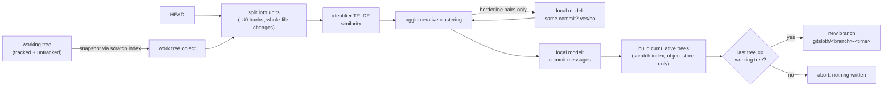

# gitsloth

**Hack for six hours without staging a single file. Run `gitsloth`. Get a clean, reviewable commit history on a new branch. Your working tree is never touched.**

gitsloth reads your uncommitted changes (modified, new and deleted files), groups the individual hunks by purpose, has a local open-weight model write the commit messages, and builds the commits on a *new* branch. It will not write that branch unless the last commit's tree is **byte-identical** to your working tree, so the model can only decide *how changes are grouped*, never *what the changes are*.

Everything runs on your machine: [Ollama](https://ollama.com) + `llama3.2:3b` by default. Your code is never sent anywhere (the client refuses any non-loopback host).

A real run (not staged): three consecutive commits from [execa](https://github.com/sindresorhus/execa) squashed into 7 modified files, split by `llama3.2:3b` on a CPU-only Intel Mac.

```
$ gitsloth --report review.html
19 changes to sort
4 groups by identifier overlap

* Remove verbose logging in `execa`                     (6 changes, 3 files)   docs/debugging.md, readme.md, types/methods/main-async.d.ts
* Update version in package.json                        (1 change, 1 file)
* Add detailed error, verbose mode and custom logging   (1 change, 1 file)     readme.md
* Add: duplex() can be piped to errored stream ...      (11 changes, 3 files)  test/convert/*.js

19 changes -> 4 commits in 305s (4 local model calls, 2004 tokens)
Created branch gitsloth/HEAD-20261024-015315. Your working tree, index and 'HEAD' are untouched.
```

The authors' real history for that range was three commits: a version bump, a docs section on custom logging, and a stream-test fix. gitsloth isolated the tests and the version bump correctly, but split the docs change in two, and its wording is only partly right (the first message says "Remove" for what is a large *addition* of documentation). That is the honest state of a 3B model; see the evaluation below.

## Why this exists

Everyone knows the shape of a good history: small commits, one purpose each, messages that say why. Almost nobody produces it while actually working, because staging hunks (`git add -p`) interrupts the one thing you're trying to do: think. gitsloth is for the lazy path: write first, tidy later, and let a model do the tidying without ever being able to lose your work.

## How it works



1. **Snapshot.** The working directory is captured as a tree object through a throwaway index, so your real index and files are never read for writing.
2. **Units.** The diff against `HEAD` is split into indivisible units: single `-U0` hunks of text files, or whole-file changes (new, deleted, binary, symlink, mode change, or files with more than 40 hunks).
3. **Similarity.** Each unit gets a TF-IDF vector over the identifiers in its changed lines, its function header and its file name. `flag_value` appearing in a source hunk, a test and a changelog line is a strong link; no model needed.
4. **Clustering.** Average-linkage agglomerative clustering. Pairs above a high threshold merge on their own; pairs in a borderline band are put to the local model as a yes/no question; the rest never merge.
5. **Messages.** The model writes one subject (and an optional one-sentence body) per group.
6. **Build.** Each group's hunks are applied cumulatively to the base file contents in memory, written as blobs/trees through the scratch index, and chained with `git commit-tree`.
7. **Verify, then write.** Only if the final tree equals the snapshot does a branch ref get created.

## Safety properties (each one has a test)

- **The final tree is exactly your working state.** Checked by tree hash on every run; 25 randomized repos (new, deleted, binary, CRLF, no trailing newline, empty files, nested new directories) times random groupings in `tests/test_engine.py`.
- **Your working tree, index and current branch are never modified**, including when you have partially staged files. Only `--adopt` moves your branch, and only after re-verifying.
- **A misbehaving model cannot corrupt anything.** Unknown group ids, "NEW" for everything, empty messages: covered in `tests/test_cli.py`. The worst case is a worse grouping.
- **No network.** The Ollama client rejects any host that is not loopback.
- **Nothing is deleted.** The old tip is printed; the new history lives on its own branch until you adopt it.

## Does the grouping actually work?

Honest answer: partly, and here is how I measured it.

**Method.** For real open-source repos, take *k* consecutive commits, squash them into one "messy working state", ask gitsloth to split it again, and compare with the commits the authors actually made. Ground truth is `git blame` (each change is attributed to the commit that wrote it; ambiguous changes are dropped). The score is the **adjusted Rand index (ARI)**: 1.0 = same partition as history, ~0 = no better than chance, so "put everything in one commit" scores 0.

I tuned thresholds on five repos (`click`, `flask`, `requests`, `jinja`, `werkzeug`) and then evaluated once on repos the tuning never saw (`fd`, `execa`, `commander.js`).

| grouping method | dev repos (5 cases)* | held-out test repos (18 cases) |
|---|---|---|
| everything in one commit | 0.00 | 0.00 |
| one commit per file | 0.31 | 0.34 |
| **gitsloth default (identifier overlap, no model)** | 0.50 | **0.45** |
| gitsloth `--judge` (model decides borderline pairs) | 0.52 | 0.55 vs 0.55 for default (5 cases) |

Mean ARI, higher is better. \*Dev thresholds were chosen on a 13-case sweep over 5 repos, so the dev column is optimistic by construction; the held-out column is the honest one. On the held-out cases the default beat "one commit per file" in 13, tied in 1 and lost in 4 (median 0.41 vs 0.27). It is a clear improvement over the obvious baseline and nowhere near perfect: ARI 0.45 means the grouping usually needs a human skim.

The `--judge` result is the surprising one: asking the model about borderline pairs changed the score by about +0.01 (dev, 5 cases) and +0.00 (held-out, 5 cases) while costing minutes of CPU time, so it is off by default. I only ran the judge on 10 of the 23 cases, so treat that as "no evidence it helps", not "proven useless".

What I learned the hard way: my first version asked the 3B model to place each hunk in a group, one at a time. On the first real case (`click`) it scored pairwise F1 0.40 against 0.48 for plain "one commit per file", and took about 20 seconds per change. (I then switched metrics to ARI, because pairwise F1 rewards lumping everything into one commit; that first run was not re-scored.) Reading a handful of changed lines is not enough for a small model to tell a bug fix from a refactor in the same file. Identifier overlap is a surprisingly strong, free signal, so the model now only handles the borderline pairs and the wording.

## Why open-weight, local models

- Your uncommitted code is the most sensitive thing on your machine (secrets-adjacent, unreleased, client work). It never leaves it.
- It runs on a plane, costs nothing per commit, and you can swap the model (`--model`), or fine-tune one on your team's commit style.
- The model has a deliberately small job and a hard guard rail, which is exactly what makes a 3B model on a laptop CPU usable.

## Install and use

```bash
pip install -e .            # no runtime dependencies
ollama pull llama3.2:3b
gitsloth --dry-run          # show the plan only
gitsloth --report review.html   # create the branch + an offline HTML review page
git log --stat main..gitsloth/main-<time>
gitsloth --adopt            # or: move your branch to the new history (working tree unchanged)
```

## Limitations

- It splits at hunk granularity (`-U0`). Two logically separate edits on adjacent lines become one unit.
- Intermediate commits are not guaranteed to build or pass tests (only the last is guaranteed identical to your tree).
- Grouping quality is modest on large, tangled changes; always skim the review page.
- Staged vs unstaged distinction is ignored: everything uncommitted is treated as one pile.
- Commit messages come from a 3B model and are mixed: in the run above two of four were accurate. An early version copied the example sentence from my own prompt verbatim into a commit message ("Add retry limit to HTTP client" on a change that had nothing to do with retries) until I removed the example. Always read the review page; a bigger model (`--model`) helps.
- It is slow on a laptop CPU: the grouping is instant, but writing 4 messages took about 5 minutes on an Intel Mac. It is meant to run while you make coffee, or overnight.

## Layout

```
gitsloth/units.py       hunks and whole-file units from a tree diff
gitsloth/similarity.py  identifier TF-IDF
gitsloth/plan.py        clustering + model judge + messages
gitsloth/build.py       trees, commits, the invariant
gitsloth/report.py      offline HTML review page
gitsloth/llm.py         loopback-only Ollama client
eval/replay.py          the replay benchmark   eval/tune.py  threshold sweep (dev repos only)
```

MIT licensed. Model weights are downloaded separately through Ollama under their own licenses.
